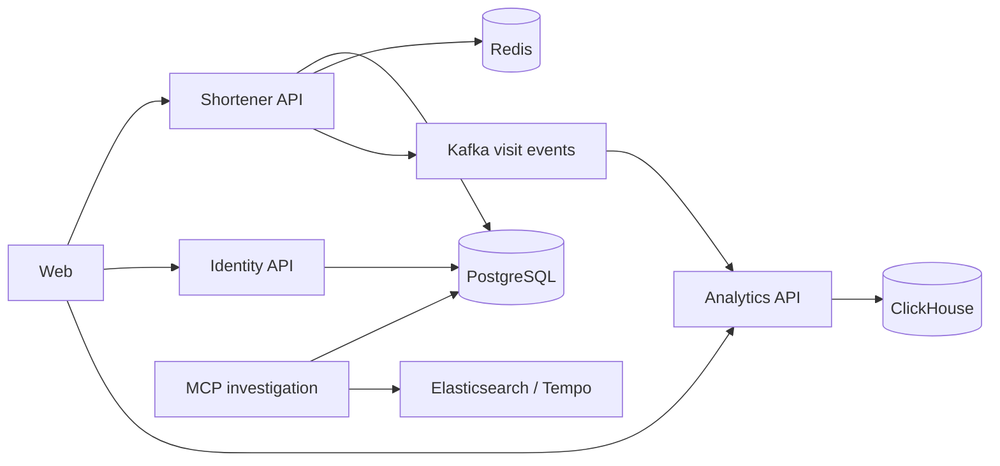

# Sandbox URL Shortener

An educational URL shortener built to explore Go service boundaries, persistence, caching,
event-driven analytics and incident investigation. The repository includes a browser application,
separate backend services and a local observability stack.

## Implemented Features

- Create, list and inspect links; enable/disable them and soft-delete them.
- Redirect short codes with expiration dates, click limits and redirect counters.
- Redis-backed redirect caching, cache invalidation, create-request rate limiting and idempotency.
- Visit events through Kafka, ClickHouse analytics, statistics API and browser views.
- Separate identity service with password login, browser sessions and CSRF protection.
- Optional Google and Apple login; each provider requires your own credentials and callback setup.
- Structured logs, request/trace correlation, metrics dashboards and distributed traces.
- Nine read-only MCP tools for logs, traces and bounded SELECT queries over approved database views.

Accounts and browser login are implemented. Link ownership and per-user authorization for the
shortener API remain planned; the current link collection is shared.

## Quick Start

From the repository root, with these tools available:

- A running Docker Engine or Docker Desktop, with Docker Compose v2.
- [Task](https://taskfile.dev/), available as `task`.
- `curl`, used by the local smoke checks.

Create the local environment file if it does not already exist, then deploy:

```bash
if [ ! -f .env ]; then
  cp .env.example .env
fi
task deploy
```

`task deploy` builds and starts the Compose stack, applies shortener and identity migrations,
prepares the MCP database reader/views, and checks service readiness and the web page.
It does not run the local lint/test/build quality gates. Docker images supply Go and Node.js,
so neither is needed on the host for this deployment path.

Open [the web application](http://localhost:3000/). The first deployment pulls and builds the
application and infrastructure images; the full observability stack uses more resources than
the URL API alone.

Default local endpoints:

| Component | Address | Purpose |
| --- | --- | --- |
| Web | [localhost:3000](http://localhost:3000/) | Links, statistics and login |
| Shortener | [localhost:8080](http://localhost:8080/health/ready) | Link API and redirects |
| Identity | [localhost:8081](http://localhost:8081/health/ready) | Accounts and sessions |
| Analytics | [localhost:9090](http://localhost:9090/health/ready) | Statistics API |
| Grafana | [localhost:3001](http://localhost:3001/) | Dashboards |
| Prometheus | [localhost:9091](http://localhost:9091/) | Metrics |
| Kibana | [localhost:5601](http://localhost:5601/) | Log search |
| Elasticsearch | [localhost:9200](http://localhost:9200/) | Log index |
| Tempo | [localhost:3200](http://localhost:3200/ready) | Trace backend |
| MCP | [localhost:8090/mcp](http://localhost:8090/mcp) | Authenticated MCP endpoint |

MCP is published on loopback only. PostgreSQL, Redis, Kafka and ClickHouse are also part of the
Compose stack; their development configuration is in
[docker-compose.yml](deploy/docker-compose/docker-compose.yml).

## Try The API

Create a link without logging in:

```bash
curl -sS -X POST http://localhost:8080/api/v1/links \
  -H 'Content-Type: application/json' \
  -H 'Idempotency-Key: readme-demo-create' \
  -d '{"original_url":"https://example.com","title":"Example"}'
```

The JSON response includes `id`, `short_code` and `short_url`. Open the returned `short_url`
to follow a `302` redirect to the original URL. `title` is optional; creation also accepts
`expires_at` and `max_clicks`. Reuse an idempotency key for retries of the same creation request,
and choose a new key for a different request.

List the current links:

```bash
curl -sS http://localhost:8080/api/v1/links
```

The browser provides the link detail, enable/disable, delete and statistics flows. HTTP handlers
and response types live under `services/shortener/internal/transport/http/stdlib`.

## Architecture And Stack

Go services use Go 1.25, `net/http` and explicit `handler/router -> service -> repository` layers.
PostgreSQL access uses pgx; Redis provides caching, rate limiting and idempotency. Kafka transports
visit events to the analytics service, which stores and queries them in ClickHouse.

The web service uses Next.js 16, React 19 and TypeScript. Identity owns accounts, password
credentials, browser sessions and OAuth integration separately from link management.



Structured application logs flow through Fluent Bit into Elasticsearch/Kibana. Prometheus and
Grafana cover metrics; OpenTelemetry exports traces to Tempo. These support request-level
investigation as well as k6 load-testing workflows.

Repository layout:

```text
services/
  shortener/    link API, redirects, persistence and migrations
  identity/     accounts, sessions, OAuth and maintenance
  analytics/    visit consumer, ClickHouse writes and statistics API
  web/          Next.js application and frontend dependencies
  mcp-logs/     MCP transports and read-only investigation tools
internal/platform/  shared logging, telemetry, health and HTTP infrastructure
deploy/             Compose, Helm, kind and orchestration assets
docs/               architecture and operational runbooks
ai/plan/            implementation tasks and epics
```

Configuration, migrations and Dockerfiles stay inside their owning service. `Taskfile.yaml`
is the default quality/lifecycle entrypoint; `Makefile` contains narrower runtime and migration
helpers.

## Local Development And Validation

For host-side checks, install Go 1.25 and Node.js 24 with npm. Go lint/format tools are installed
into `bin/` by their Task targets. Use the pinned Go toolchain for compatibility with the linter:

```bash
GOTOOLCHAIN=go1.25.0 task test
GOTOOLCHAIN=go1.25.0 task build
GOTOOLCHAIN=go1.25.0 task lint
```

`task verify` combines Go lint, tests and builds with the web dependency installation and build:

```bash
GOTOOLCHAIN=go1.25.0 task verify
```

Frontend tests can be run separately after installing dependencies:

```bash
npm --prefix services/web ci
npm --prefix services/web test
```

Once the stack is running, useful runtime checks are:

```bash
task smoke
task load:smoke
task load:mixed
task load:mixed:metrics
```

The load tasks run k6 in Docker. The metrics variant exports results to Prometheus; see the
[load-testing runbook](docs/load_testing_workflows.md) for scenarios, thresholds and tuning.

`task stop` removes the Compose containers and network while preserving named volumes.
`task reset` also deletes the volumes and their local data.

## MCP Investigation

The MCP service supports authenticated Streamable HTTP and the existing stdio transport. Its
fixed tool set discovers services/fields, groups errors, follows requests/traces, and exposes
`list_databases`, `describe_database` and `query_database` for approved PostgreSQL data.

```bash
task mcp:start
task mcp:restart
task mcp:status
task mcp:logs
task mcp:stop
```

These commands operate on MCP independently of its clients and the other services. Start/restart
does not start its upstream backends; `task mcp:db:prepare` separately provisions the local reader
and audited views. MCP readiness does not depend on Elasticsearch, Tempo or PostgreSQL being up;
an unavailable backend fails its corresponding tools.

The key in [keys.go](services/mcp-logs/internal/app/keys.go) is an intentionally public fixture
for local educational/demo use, not a production credential. Production needs private keys from
protected configuration or a secret store. HTTP requests authenticate with issued bearer keys;
session IDs alone do not grant access. Client setup and key rotation are documented in the
[MCP service README](services/mcp-logs/README.md).

The approved database view excludes original URLs, account identifiers and credentials. SELECTs
use typed bind parameters, validated syntax and explicit read-only transactions, with a 5-second
statement timeout, at most 100 rows/64 columns and a 32-KiB response budget. Per-team data policies
for a shared MCP deployment remain future work.

## Further Reading

- [System design](docs/system_design.md) and [architecture blueprint](docs/architecture_blueprint.md)
- [Identity and authentication](docs/identity_auth_service.md)
- [Local delivery and recovery](docs/local_delivery_workflows.md)
- [Logs and debugging](docs/log_debugging_workflows.md)
- [Metrics and tracing](docs/metrics_and_tracing_workflows.md)
- [Local Kubernetes with kind and Helm](docs/local_kubernetes_workflows.md)
- [Migrations](docs/migrations.md)
- [Task and epic index](ai/plan/README.md)

Docker Compose is the default local runtime. Gateway deployment and account-scoped URL ownership
are tracked as follow-up work; provider OAuth setup requires your own Google/Apple credentials.
