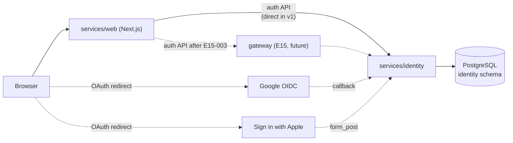
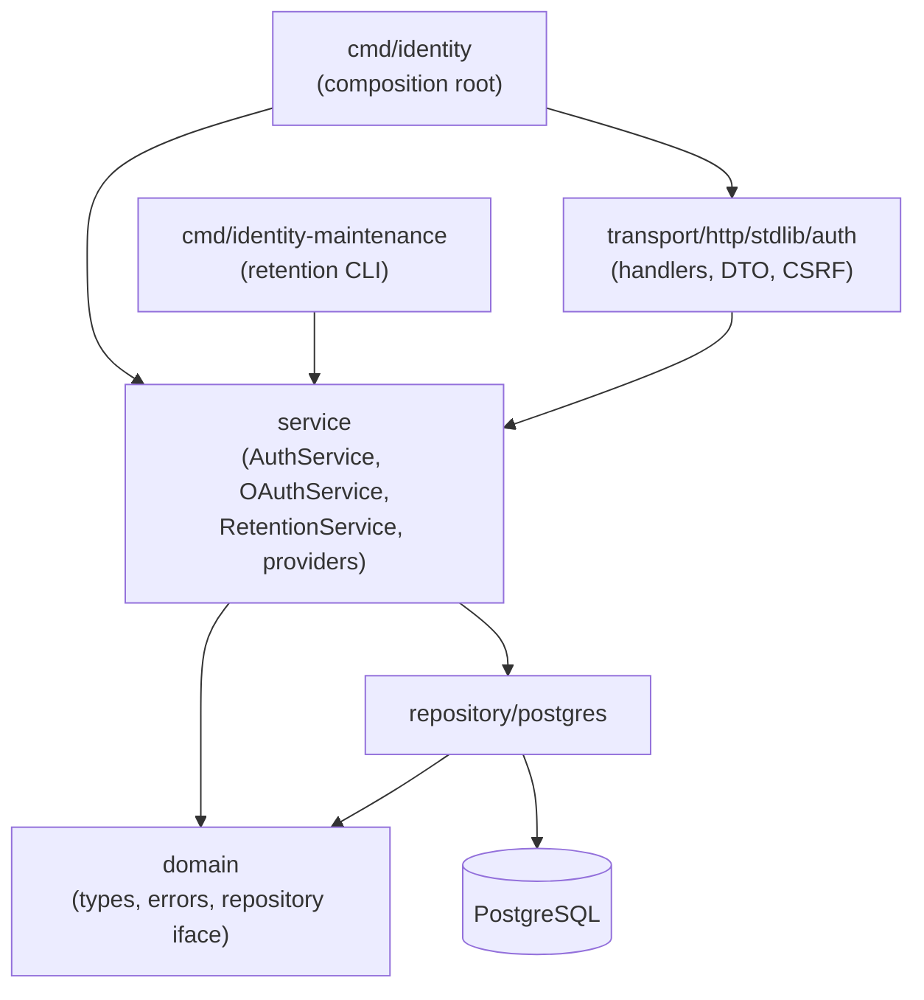
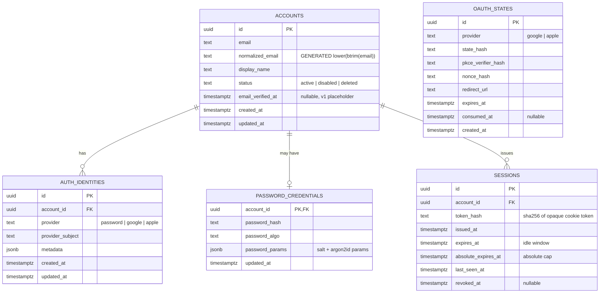
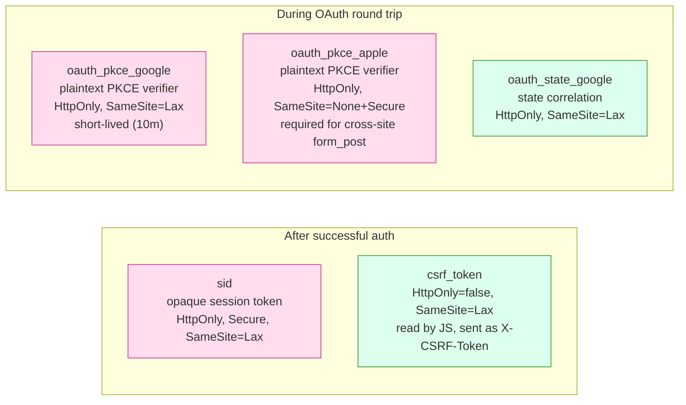
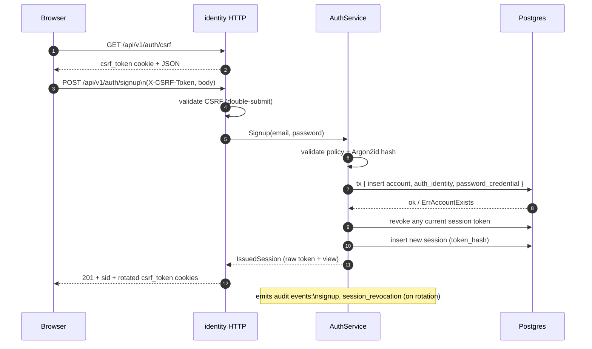
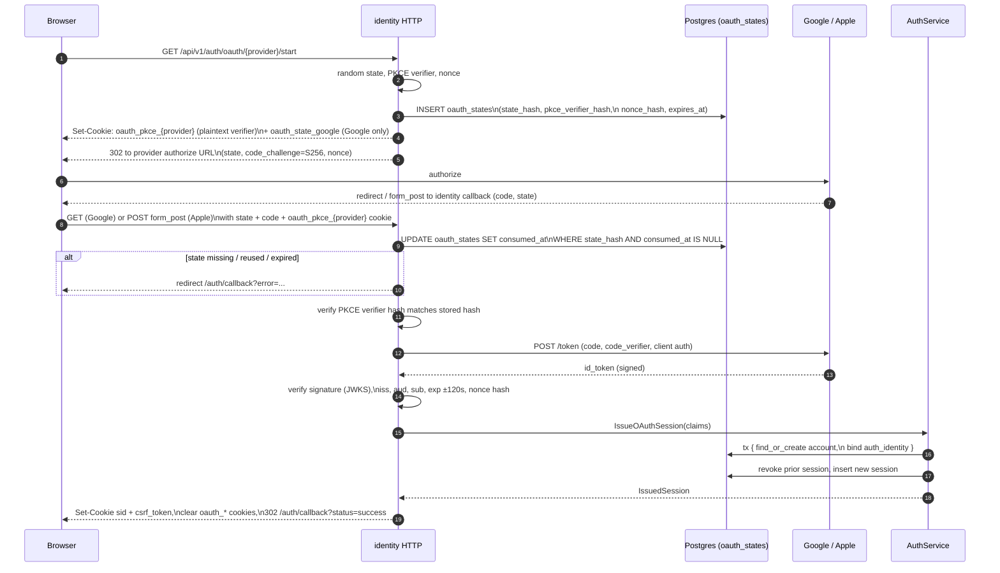
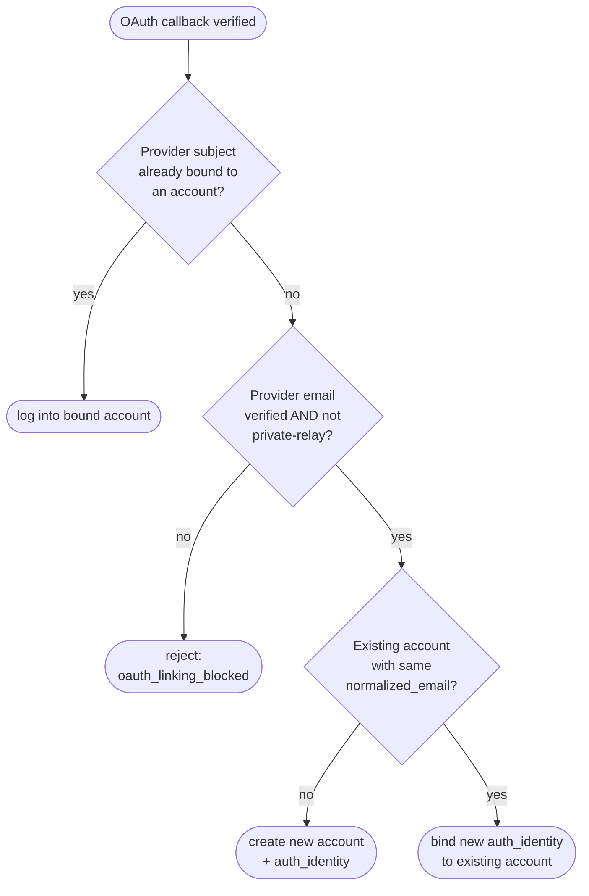

# Identity Auth Service

## Purpose

`services/identity` owns accounts, authentication methods, browser sessions, CSRF tokens, and
OAuth login. It is a separate Go backend service that uses PostgreSQL as the source of truth and
exposes HTTP contracts for `services/web` now and the future API gateway in E15.

The service follows the repository layout rules from `AGENTS.md`:

- transport: `services/identity/internal/transport/http/stdlib`
- service logic: `services/identity/internal/service`
- persistence: `services/identity/internal/repository/postgres`
- domain contracts: `services/identity/internal/domain`
- config and composition root: `services/identity/internal/config` and
  `services/identity/internal/app`

Handlers parse HTTP input, call service methods, and map domain errors to transport-safe JSON.
Services own auth decisions, session rotation, audit events, and OAuth orchestration. Repositories
own SQL only.

## Component Context



The same identity HTTP contract serves the browser today and any future backend caller (gateway,
admin tooling) tomorrow without contract changes; the only migration step is swapping the
configured base URL in the web client.

## Internal Layout



Layering rules from `AGENTS.md` apply: handlers never touch SQL, services own business logic and
side-effect ordering, repositories carry persistence only.

## Runtime

The default local service port is `8081`.

Key local URLs:

- identity API: `http://localhost:8081`
- web app: `http://localhost:3000`
- web auth callback page: `http://localhost:3000/auth/callback`

The Docker Compose stack wires identity alongside the existing shortener, analytics, PostgreSQL,
observability, and web services. Identity has its own Dockerfile and service-owned PostgreSQL
migrations under `services/identity/migrations/postgres`.

Identity migrations use their own golang-migrate metadata table:
`schema_migrations_identity`. This is required because the local bootstrap stack currently keeps
shortener and identity tables in the same PostgreSQL database while each service owns a separate
`000001` migration sequence.

## Configuration

Required:

- `DB_DSN`: PostgreSQL DSN for identity state

Common identity settings:

- `IDENTITY_APP_PORT`: HTTP port, default `8081`
- `IDENTITY_PUBLIC_BASE_URL`: public identity base URL, default `http://localhost:8081`
- `WEB_ORIGIN`: allowed browser origin for CORS, default `http://localhost:3000`
- `WEB_AUTH_CALLBACK_URL`: web callback landing page, default
  `http://localhost:3000/auth/callback`
- `IDENTITY_COOKIE_SECURE`: whether auth cookies are marked `Secure`, default `true`
- `IDENTITY_COOKIE_DOMAIN`: optional cookie domain
- `IDENTITY_SESSION_ABSOLUTE_DAYS`: absolute session lifetime, default `30`
- `IDENTITY_SESSION_IDLE_DAYS`: idle sliding window, default `7`
- `IDENTITY_OAUTH_STATE_RETENTION_HOURS`: retention for expired or consumed OAuth state rows,
  default `24`. Short by design: a consumed state has no value beyond the immediate
  failed-callback diagnostic window.
- `IDENTITY_SESSION_RETENTION_DAYS`: retention for revoked or expired session rows, default `30`.
  Matches `IDENTITY_SESSION_ABSOLUTE_DAYS` so forensic lookback covers a full session lifetime
  before rows are removed.
- `IDENTITY_RETENTION_DELETE_BATCH_SIZE`: maximum rows removed by one cleanup delete statement,
  default `1000`
- `IDENTITY_MAINTENANCE_TIMEOUT_SECONDS`: maximum duration for one maintenance command run,
  default `120`

Google OAuth:

- `GOOGLE_OAUTH_CLIENT_ID`
- `GOOGLE_OAUTH_CLIENT_SECRET`
- `GOOGLE_OAUTH_REDIRECT_URL`

Apple OAuth:

- `APPLE_OAUTH_CLIENT_ID`
- `APPLE_OAUTH_TEAM_ID`
- `APPLE_OAUTH_KEY_ID`
- `APPLE_OAUTH_PRIVATE_KEY_PEM`
- `APPLE_OAUTH_REDIRECT_URL`

If provider redirect URLs are empty, the service derives them from `IDENTITY_PUBLIC_BASE_URL`:

- `/api/v1/auth/oauth/google/callback`
- `/api/v1/auth/oauth/apple/callback`

For one-line environment values, `APPLE_OAUTH_PRIVATE_KEY_PEM` may use literal `\n` escapes.

OAuth providers are optional. If a provider is not fully configured, its start endpoint returns the
stable `oauth_unconfigured` error.

## Storage Model

Identity storage is service-owned PostgreSQL.



Key invariants:

- `accounts.normalized_email` is unique among non-deleted rows
- `auth_identities` is unique by `(provider, provider_subject)`
- `sessions.token_hash` is unique only among non-revoked rows (partial unique index)
- `oauth_states.(provider, state_hash)` is unique; rows are single-use and short-lived
- `oauth_states` never holds the plaintext PKCE verifier — only its hash

`accounts` stores stable internal account data:

- `id`: UUID primary key
- `email`: primary email value
- `normalized_email`: generated stored column, `lower(btrim(email))`
- `display_name`
- `status`: `active`, `disabled`, or `deleted`
- `email_verified_at`: nullable placeholder for future verification flows
- timestamps

Active, non-deleted accounts are unique by `normalized_email`.

`auth_identities` stores authentication method bindings:

- `account_id`
- `provider`: `password`, `google`, or `apple`
- `provider_subject`: durable provider subject
- `metadata`: provider-specific JSON

Provider bindings are unique by `(provider, provider_subject)`.

`password_credentials` stores password material separately from account data:

- `account_id`
- `password_hash`
- `password_algo`
- `password_params`
- `updated_at`

Passwords use Argon2id. Raw passwords are never persisted or logged.

The v1 credential format keeps Argon2id parameters, including the salt, inside
`password_params`. This keeps the password hash and parameter set versioned together during the
bootstrap phase. A dedicated salt column is not required for correctness because the salt is not
secret, but the format should be revisited before adding multiple password algorithms or external
credential migration tooling.

`sessions` stores browser session state:

- opaque browser token hash, not the raw token
- issue, idle expiry, last-seen, revocation, and absolute expiry timestamps
- account foreign key

Only active token hashes are unique. Revoked sessions do not permanently reserve the hash namespace.

`oauth_states` stores temporary OAuth state:

- provider
- `state_hash`
- `pkce_verifier_hash`
- `nonce_hash`
- redirect URL
- expiry and consumed timestamps

OAuth state is single-use and expires after `10m`. The plaintext PKCE verifier is not stored in the
database.

## HTTP API

All state-changing cookie-authenticated endpoints require the double-submit CSRF header.

### `GET /api/v1/auth/csrf`

Issues a CSRF token for browser callers.

Response:

```json
{
  "csrf_token": "opaque-token",
  "header": "X-CSRF-Token",
  "cookie": "csrf_token"
}
```

Cookie:

- name: `csrf_token`
- `HttpOnly=false`
- `SameSite=Lax`
- `Path=/`
- TTL: `1h`

The web client caches the bootstrap result for the page lifetime and refetches only after
`invalid_csrf`.

### `POST /api/v1/auth/signup`

Creates a password account and issues a fresh session.

Request:

```json
{
  "email": "user@example.com",
  "display_name": "User",
  "password": "at least 12 chars"
}
```

Rules:

- email is trimmed and normalized for uniqueness
- password length must be at least `12` chars and at most `72` bytes
- duplicate active account email returns `account_exists`
- successful signup rotates any existing session cookie supplied by the browser

### `POST /api/v1/auth/login`

Verifies password credentials and issues a fresh session.

Request:

```json
{
  "email": "user@example.com",
  "password": "at least 12 chars"
}
```

Rules:

- unknown account and bad password both return generic `unauthorized`
- unknown-account login still runs a dummy Argon2id hash to reduce timing leakage
- successful login rotates any existing session cookie supplied by the browser

### `GET /api/v1/auth/session`

Returns the current browser session.

The endpoint reads the `sid` cookie. Missing, expired, revoked, or disabled-account sessions return
an auth error.

Successful response:

```json
{
  "account": {
    "id": "uuid",
    "email": "user@example.com",
    "display_name": "User",
    "email_verified": false,
    "providers": ["password"]
  },
  "session": {
    "expires_at": "2026-04-28T12:00:00Z"
  }
}
```

Session validation slides `expires_at` within the absolute session cap when the session is active.

### `POST /api/v1/auth/validate`

Uses the same handler and response contract as `GET /api/v1/auth/session`. This exists for backend
callers that prefer POST validation semantics.

### `POST /api/v1/auth/logout`

Revokes the current `sid` session if present and clears browser auth cookies. Repeated logout is
safe. Missing or unknown sessions still emit audit events with stable reason codes.

## Cookies And CSRF

The browser ends up with a small set of cookies that play distinct roles:



Session cookie:

- name: `sid`
- value: opaque random token
- stored server-side only as a hash
- `HttpOnly=true`
- `Secure` follows `IDENTITY_COOKIE_SECURE`
- `SameSite=Lax`
- `Path=/`
- expiry follows the current session expiry

CSRF cookie:

- name: `csrf_token`
- value: opaque random token
- `HttpOnly=false`
- `Secure` follows `IDENTITY_COOKIE_SECURE`
- `SameSite=Lax`
- `Path=/`

State-changing browser requests must send:

```http
X-CSRF-Token: <csrf_token cookie value>
```

The CSRF token is also rotated after successful authentication. The rotated value is delivered via
cookie, not in the signup/login JSON response.

## Password Flow



Signup:

1. Handler validates CSRF and decodes JSON.
2. Service validates email and password policy.
3. Service hashes the password with Argon2id and persisted params.
4. Repository creates the account, password credential, and password auth identity.
5. Service revokes any current session token supplied by the browser.
6. Service issues a new opaque session token.
7. Handler sets `sid` and rotated `csrf_token` cookies.
8. Service emits structured audit logs for signup and session rotation when applicable.

Login:

1. Handler validates CSRF and decodes JSON.
2. Service loads the password account by normalized email.
3. Unknown account runs a dummy password hash before returning `unauthorized`.
4. Bad password returns the same generic `unauthorized`.
5. Successful login rotates any current session and issues a new session.
6. Handler sets `sid` and rotated `csrf_token` cookies.
7. Service emits structured audit logs for success, failure, and session rotation.

## OAuth Flow

OAuth supports Google and Apple through provider implementations behind the `OAuthProvider`
interface.



Provider differences:

| Aspect | Google | Apple |
| --- | --- | --- |
| Callback transport | GET (query string) | POST `form_post` (cross-site) |
| State cookie | `oauth_state_google`, `SameSite=Lax` | none — DB state is canonical |
| PKCE cookie SameSite | `Lax` | `None` (requires `Secure`/HTTPS) |
| `client_secret` | static value | ES256 JWT, cached briefly |
| First-auth `user` form | n/a | unsigned, used for display name only |
| Email source | id_token `email` claim | id_token `email` claim only |

Start:

1. Service generates opaque `state`, PKCE verifier, and OIDC nonce.
2. Service stores hashes for state, PKCE verifier, and nonce in `oauth_states`.
3. Service returns the provider authorization URL.
4. Handler redirects the browser to the provider.

Temporary browser cookies:

- `oauth_state_<provider>` is used for Google state correlation.
- Apple does not use this state cookie because Apple callbacks use cross-site `form_post`.
- `oauth_pkce_<provider>` stores the plaintext PKCE verifier for the callback exchange.
- Apple PKCE cookie uses `SameSite=None`; Google PKCE cookie uses `SameSite=Lax`.
- Browsers reject `SameSite=None` cookies that are not also `Secure`, so the Apple flow
  requires `IDENTITY_COOKIE_SECURE=true` and HTTPS at the identity origin. Local Apple OAuth
  cannot work over plain HTTP.

Callback:

1. Handler reads provider callback parameters.
2. Handler requires state and PKCE verifier.
3. Service consumes the DB state by `state_hash`; reuse is rejected.
4. Service verifies the PKCE verifier hash.
5. Provider exchanges the authorization code for tokens.
6. Provider verifies ID-token signature and common OIDC claims.
7. Service applies account-linking rules and issues a shared identity session.
8. Handler sets `sid`, rotates CSRF, expires OAuth cookies, and redirects to the web callback page.

Common OIDC checks:

- issuer
- audience
- subject
- expiry with `120s` leeway
- `iat` not too far in the future
- nonce hash

Google:

- verifies ID-token signature using provider JWKS
- requires verified email for primary account creation or linking

Apple:

- generates ES256 `client_secret` JWT with configured team, key, and client id
- caches signed client secrets briefly to avoid per-request ECDSA work
- uses only the signed ID-token email claim for account identity
- treats unsigned `user.name` from first authorization response as display-only metadata
- rejects private-relay or missing-email states when they would create unsafe account linking

## Account Linking

Provider subject plus provider name is the durable OAuth login identity.



When an OAuth provider subject is already bound, identity logs into that account.

When a provider subject is new:

- the provider email must be verified
- linking to an existing account is allowed only when the verified provider email matches the
  account's primary normalized email
- unsafe linking states return `oauth_linking_blocked`
- unverified provider email cannot create a new primary-email account

This keeps email as account metadata and provider subject as the OAuth login key.

## Error Contract

Errors are returned as transport-safe JSON:

```json
{
  "error": {
    "code": "unauthorized",
    "message": "authentication required",
    "request_id": "request-id"
  }
}
```

Stable auth-facing codes include:

- `validation_error`
- `account_exists`
- `unauthorized`
- `invalid_csrf`
- `account_disabled`
- `oauth_unconfigured`
- `oauth_linking_blocked`
- `invalid_oauth_state`
- `oauth_state_expired`
- `oauth_provider_invalid`

The web client maps these codes to user-safe messages in `services/web/lib/identity-api.ts`.

## Audit Logs

Identity emits structured logs with stable fields and without raw credentials, tokens, codes,
ID tokens, or full submitted payloads.

Audit events use:

- `operation=auth_audit`
- `event`
- `account_id`
- `normalized_email_hash`
- `client_ip`
- `user_agent`
- `reason_code`

Current events include:

- `signup`
- `login_success`
- `login_failure`
- `logout`
- `session_revocation`

Operational session issuance logs use `operation=auth_session_issue`.

## Web Integration

`services/web` calls identity directly until E15 moves auth behind the gateway.

Frontend config:

- `NEXT_PUBLIC_IDENTITY_API_BASE_URL`

If the env var is missing in local browser development, web defaults to `http://localhost:8081`.
For non-local browser hosts, missing config fails loudly instead of silently pointing at localhost.

Web auth routes:

- `/auth`: password signup/login and provider entry links
- `/auth/callback`: OAuth result page

The web client:

- bootstraps and caches CSRF
- retries once on `invalid_csrf`
- calls current-session rather than reading `HttpOnly` session material
- dispatches `identity-session-changed` after signup, login, and logout
- refreshes navigation after successful auth transitions

## Validation

Useful local checks:

```bash
task test
task lint
task build
npm test --prefix services/web
npm run typecheck --prefix services/web
npm run build --prefix services/web
docker compose -f deploy/docker-compose/docker-compose.yml config
```

Browser smoke should cover:

- `/auth` rendering
- signup
- login
- Google and Apple provider links
- session-aware navigation
- logout returning UI to anonymous state

## Retention Cleanup

Identity does not run a background cleanup worker in E14. Cleanup is explicit and operator-driven.

Run once:

```bash
task identity:cleanup
```

or directly:

```bash
go run ./services/identity/cmd/identity-maintenance cleanup
```

The command uses the normal identity environment, especially `DB_DSN`,
`IDENTITY_OAUTH_STATE_RETENTION_HOURS`, `IDENTITY_SESSION_RETENTION_DAYS`,
`IDENTITY_RETENTION_DELETE_BATCH_SIZE`, and `IDENTITY_MAINTENANCE_TIMEOUT_SECONDS`.

Cleanup deletes:

- `oauth_states` where `expires_at` is older than the OAuth state retention cutoff (regardless
  of consumption)
- `oauth_states` where `consumed_at` is older than the OAuth state retention cutoff
- `sessions` where `revoked_at` is older than the session retention cutoff
- `sessions` where `expires_at` or `absolute_expires_at` is older than the session retention
  cutoff

The command emits structured logs with `operation=identity_retention_cleanup`, deleted row counts,
and the cutoffs used for the run.

Cleanup deletes rows in bounded batches. Each SQL statement deletes at most
`IDENTITY_RETENTION_DELETE_BATCH_SIZE` rows and the service loops until the next batch removes
fewer rows than the configured limit or the maintenance context expires. For very large backlogs,
increase `IDENTITY_MAINTENANCE_TIMEOUT_SECONDS` or run the command repeatedly during quiet windows.

## Known Follow-Ups

Potential follow-ups after E14:

- move identity cleanup from a manual command to scheduled infrastructure when there is a real
  runtime target for it
- revisit the password credential format before adding multiple password algorithms or external
  credential migration tooling
