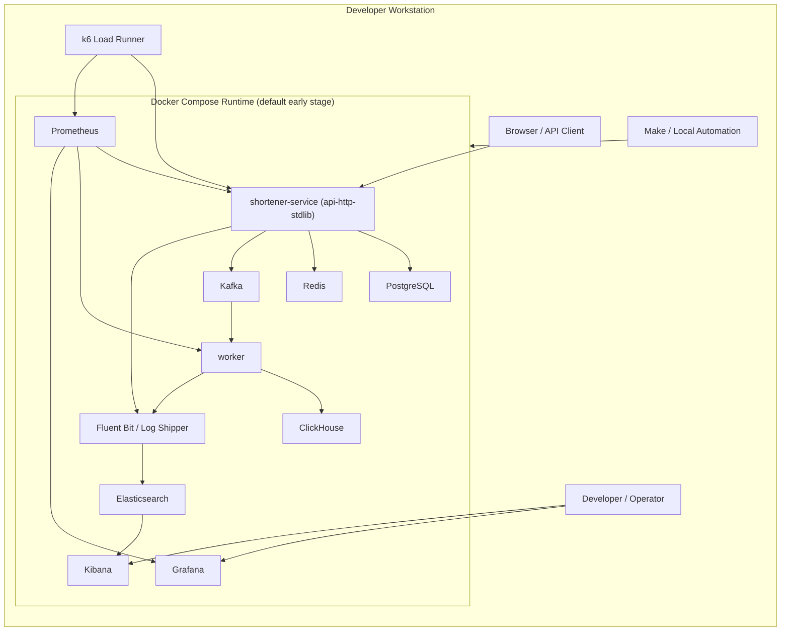
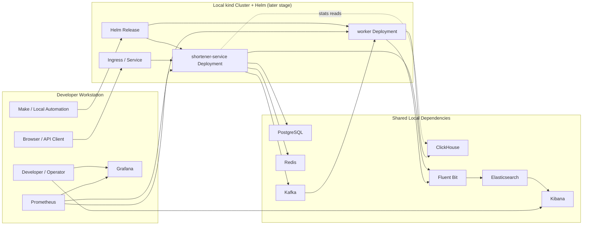
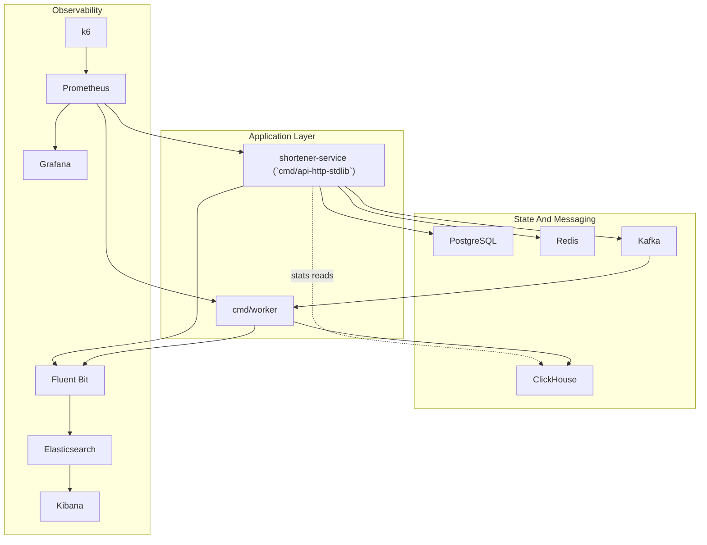
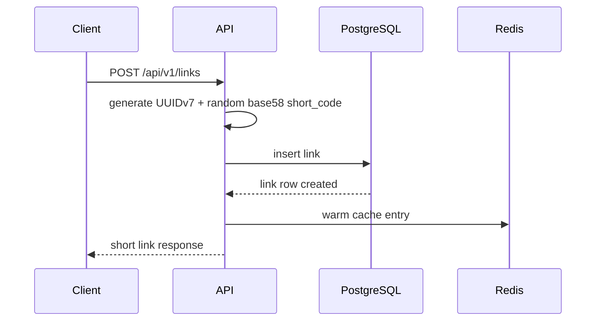
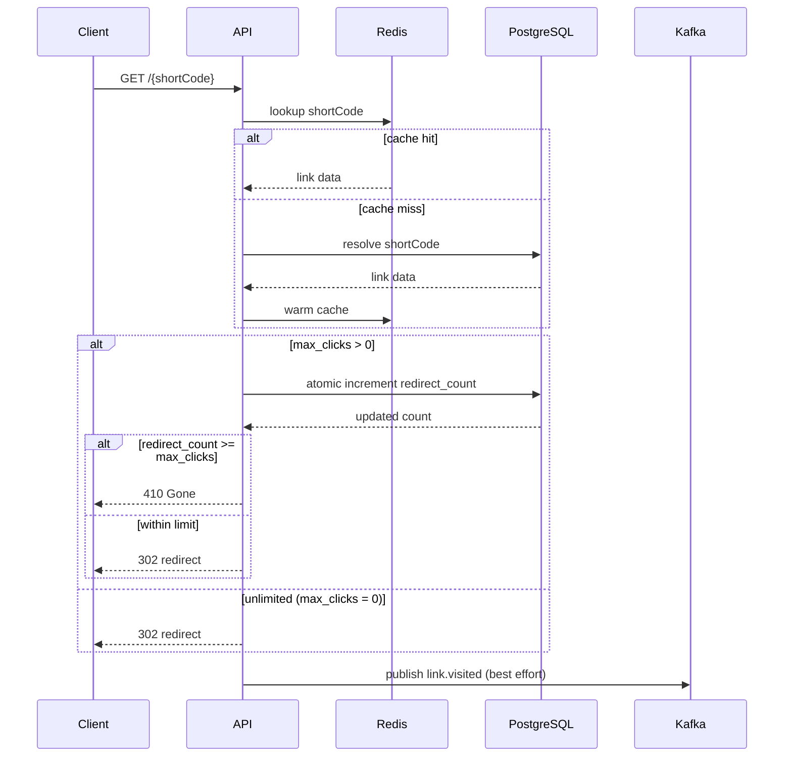
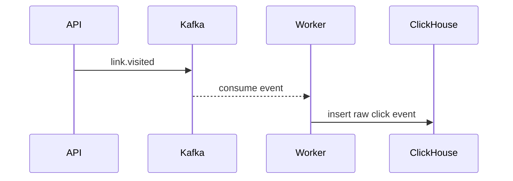
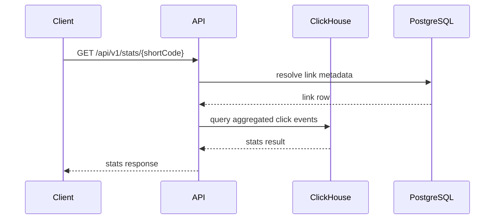

# URL Shortener System Design

## Purpose

This document is the high-level system design for the URL shortener project. It connects the
product plan, the implementation epics, and the expected runtime architecture so future work can
stay consistent.

Detailed defaults for data stores, migrations, and logging live in
`docs/data_and_logging_strategy.md`.

## Design Goals

- keep the project a modular monolith at the start
- separate user-facing request handling from async event processing
- keep the redirect path simple and fast
- treat analytics and observability as first-class concerns without coupling them to redirects
- keep the system Docker-first and practical for local development

## Scope

This design covers the MVP and the planned production-like stack:

- `shortener-service` as the main user-facing service
- `worker` service
- `k6` load generator for controlled performance testing
- PostgreSQL
- Redis
- Kafka
- ClickHouse
- Elasticsearch and Kibana
- Prometheus and Grafana
- Docker Compose as the primary local runtime
- `kind + Helm` as the later local Kubernetes runtime
- Minikube as an optional sandbox for Kubernetes learning

It does not assume Kubernetes, multi-tenancy, billing, or a distributed microservice split.

The project currently assumes local-only verification and deployment targets. There is no required
cloud or VPS environment in the baseline roadmap.

Service naming and binary naming are intentionally separate:

- service role: `shortener-service`
- current baseline binary: `cmd/api-http-stdlib`

## System Context



## Local Kubernetes Runtime

In the local kind setup, Prometheus and Grafana run outside the cluster (on the host or in Docker
Compose) and scrape application pods via `kubectl port-forward` or NodePort services. This avoids
deploying the full monitoring stack into the local cluster while still providing metrics visibility.



## Runtime View



## Internal Architecture

### `shortener-service`

The main user-facing service is `shortener-service`. Its current baseline binary is
`cmd/api-http-stdlib`, and it is implemented as a modular monolith with explicit layers:

- transport: HTTP router, handlers, middleware, UI handlers
- service: link lifecycle, redirect orchestration, stats read model
- repository: PostgreSQL, Redis, Kafka producer, future ClickHouse read adapters
- platform: config, logger, metrics, health, shutdown wiring

Expected request flow:

`HTTP -> middleware -> handler -> service -> repository/infrastructure`

Constraints:

- handlers do request parsing and response mapping only
- business rules stay in services
- storage and broker integrations stay behind repository or infrastructure boundaries
- future alternative HTTP runtimes such as `api-http-chi` or `api-http-gin` may reuse the same
  service and repository layers, but they are not part of the MVP baseline

### `worker`

The `worker` binary is intentionally narrow:

- consume Kafka messages
- validate and deserialize event payloads
- write analytics events to ClickHouse
- emit logs and metrics for consumer health

The worker must tolerate at-least-once delivery and avoid making redirect success depend on any of
its behavior.

Although `worker` is not user-facing, it exposes a lightweight HTTP server for health and metrics:

- `/health/live` and `/health/ready` for Docker and Kubernetes probes
- `/metrics` for Prometheus scraping

### Metrics And Health Port Strategy

Both `shortener-service` and `worker` expose `/health/live`, `/health/ready`, and `/metrics` over
HTTP. The port layout:

- `shortener-service`: single port for API, UI, health, and metrics (default `8080`)
- `worker`: dedicated admin port for health and metrics only (default `9090`)

In Docker Compose, health checks use the `/health/live` endpoint. In Kubernetes, liveness and
readiness probes target the same endpoints via `httpGet`.

## Storage And Platform Responsibilities

### PostgreSQL

- source of truth for links
- stores metadata such as original URL, short code, status, expiration, and timestamps
- backs administrative reads and writes

### Redis

- cache for redirect resolution
- optional rate limiting and idempotency support
- not a source of truth

### Kafka

- decouples redirect flow from analytics processing
- carries versioned `link.visited` events
- allows best-effort event publishing on the request path

### ClickHouse

- stores raw click events
- supports basic aggregations for stats pages and API responses

### Elasticsearch And Kibana

- centralize structured logs
- support request tracing by `request_id`, `short_code`, `status_code`, and error fields

### Prometheus And Grafana

- collect technical and business metrics
- provide dashboards for latency, errors, cache hit ratio, and event pipeline behavior
- act as the main visualization surface during controlled load and stress tests

### k6

- generates controlled load against local or project-owned environments
- drives steady, mixed, spike, and saturation scenarios
- exports its own runtime metrics for correlation with application and infrastructure behavior

### Docker Compose

- primary runtime for early development and most local verification
- default home for infrastructure dependencies and optional application containers
- supports a hybrid mode where infra runs in Compose and Go binaries run from the IDE

### kind And Helm

- later-stage local Kubernetes runtime for production-like deployment behavior
- used to validate probes, rollout mechanics, ingress, and Helm-based packaging locally
- not required before the core application and observability loops are stable

### Minikube

- optional sandbox for learning Kubernetes features
- not part of the default development or deployment path

## Main Flows

### Create Link



Outcome:

- link is durable in PostgreSQL
- redirect cache may be warmed optimistically
- response does not depend on Kafka or analytics subsystems

Failure tolerance:

- if Redis is unavailable during cache warm-up, the create still succeeds; the cache miss is
  handled on first redirect
- short code collision on the unique index triggers a retry with a new code, bounded to `5`
  attempts before returning an internal error

### Redirect



Outcome:

- redirect remains fast and simple for unlimited links (cache hit avoids PostgreSQL entirely)
- links with `max_clicks > 0` always confirm against PostgreSQL for atomic enforcement
- Kafka failure must not fail the redirect
- errors in publishing are logged and reflected in metrics

Failure tolerance:

- if Redis is unavailable, the redirect falls back to PostgreSQL for resolution
- if Kafka is unavailable, the redirect still succeeds; the publish failure is logged at `WARN`
  and counted in `kafka_publish_errors_total`
- if PostgreSQL is unavailable, the redirect fails with `503`; there is no stale-serve fallback
  from Redis alone because eligibility checks (expiration, disabled, deleted) require fresh state
  for correctness

### Analytics



Outcome:

- analytics are asynchronous
- worker handles retries or DLQ strategy outside the user request path

### Stats Read



Outcome:

- stats queries read from ClickHouse for click aggregations and PostgreSQL for link metadata
- `shortener-service` needs a ClickHouse read adapter in its repository layer
- stats availability is eventually consistent with the redirect event pipeline

### Observability

- applications emit structured JSON logs
- logs are shipped to Elasticsearch and explored in Kibana
- `shortener-service` and `worker` expose `/metrics`
- Prometheus scrapes metrics and Grafana visualizes them

### Load And Stress Testing

- `k6` runs against controlled environments only
- test-driver metrics should be graphed next to application metrics in real time
- infrastructure exporters for PostgreSQL and Redis should be present before serious saturation
  testing begins
- the primary target is the local Compose stack first, then the local kind runtime later

## Key Design Decisions

- start as one codebase with two binaries, not multiple services
- use `cmd/api-http-stdlib` as the canonical binary for `shortener-service` in the MVP
- keep redirect resolution `Redis -> PostgreSQL -> Redis warm-up`
- use PostgreSQL UUIDv7 ids plus separate random base58 short codes with length `7`
- return `302 Found` in the first redirect implementation
- use env-driven validated configuration
- keep metrics labels low-cardinality
- make every new infrastructure dependency runnable in Docker Compose

## API Response Conventions

API endpoints under `/api/v1/` return JSON. UI endpoints return server-rendered HTML.

Error responses use a consistent JSON shape:

```json
{
  "error": {
    "code": "link_not_found",
    "message": "short code not found or deleted",
    "request_id": "req-abc-123"
  }
}
```

Fields:

- `code`: machine-readable error identifier (snake_case)
- `message`: human-readable description
- `request_id`: correlation id from the request context

The redirect endpoint (`GET /{shortCode}`) returns HTTP status codes directly (`302`, `404`, `410`)
without a JSON body, since the client is typically a browser following a link.

## Reliability Expectations

- health endpoints distinguish liveness and readiness
- graceful shutdown is required for both `api` and `worker`
- Kafka publish failures are non-blocking for redirects
- cache failures degrade to PostgreSQL reads
- analytics pipeline is eventually consistent

## Security And Future Extensions

- no full auth in MVP, but entity boundaries should not block adding users later
- sensitive payloads and secrets must not be logged
- future extensions can include auth, custom domains, richer stats, and stronger deploy automation
  without breaking the modular monolith shape
- configuration values (ports, URLs, feature flags) use env vars validated at startup
- secrets (database passwords, Redis auth, broker credentials) also use env vars in Docker Compose;
  for Kubernetes deployments, secrets should be sourced from Kubernetes Secrets and mounted into
  pods via the Helm chart values

## Mapping To Epics

Epic numbers are stable identifiers, not a strict execution order. The recommended implementation
sequence follows the roadmap in `docs/url_shortener_codex_plan.md` section 17:

> Core backend → Redis cache → UI → Kafka events → ClickHouse analytics → Logs stack → Metrics
> stack → load/stress testing → local delivery automation → local kind + Helm runtime → optional
> HTTP transport variants

- `E01` Platform Bootstrap: runtime foundation
- `E02` Core Link Lifecycle: link CRUD and redirect source of truth
- `E03` Redirect Performance And Safety: Redis hot path and write protection
- `E04` Browser UI: usable web interface
- `E05` Event Pipeline: Kafka producer and worker
- `E06` Analytics And Stats: ClickHouse ingestion and queries
- `E07` Log Observability: Elasticsearch and Kibana
- `E08` Metrics And Dashboards: Prometheus and Grafana
- `E09` Delivery Automation: reproducible local build and verification flow
- `E10` HTTP Transport Variants: optional comparison of `chi` and `gin` after the main flow is stable
- `E11` Load And Stress Testing: k6 scenarios and performance dashboards
- `E12` Local Kubernetes And Helm: local cluster runtime after the main local stack is stable
